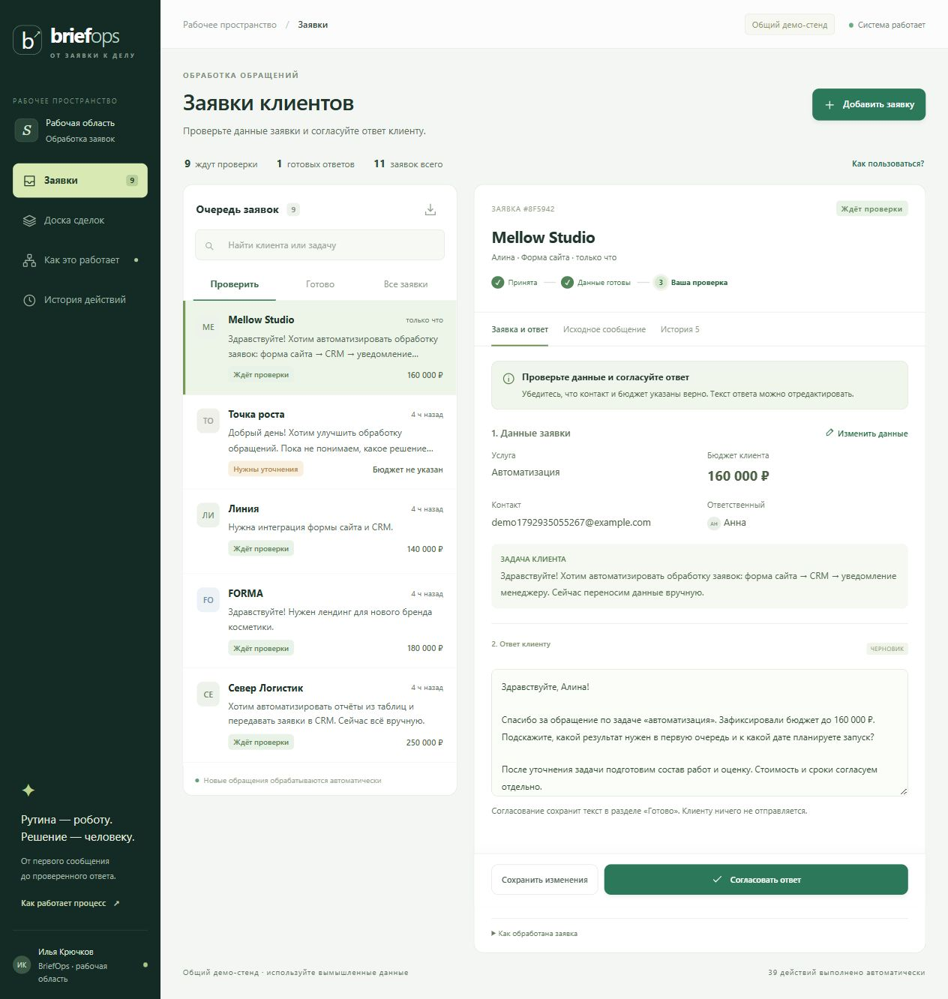

# BriefOps — автоматизация обработки входящих заявок

[Рабочее приложение](https://briefops.onrender.com) · [Исходный код](https://github.com/Rinpocheshka/briefops)

## Задача

В сервисной команде входящее обращение должно превратиться в понятную задачу: кто клиент, что ему требуется, какой у него бюджет и кто готовит ответ. При ручной обработке эти данные приходится переносить между сообщениями, таблицами и карточками сделок. Повторное обращение может создать лишнюю сделку, а незавершённый ответ — остаться без внимания.

BriefOps объединяет этот процесс в одном рабочем пространстве. Автоматика подготавливает данные и следующий шаг, менеджер проверяет результат и принимает решение.

## Рабочий сценарий

Клиент пишет: «Нужно передавать заявки с сайта в CRM и уведомлять менеджера в Telegram. Бюджет 180 тыс. рублей. Запуск в следующем месяце».

После приёма обращения система:

- сохраняет исходное сообщение и ставит его в постоянную очередь;
- определяет услугу и срочность, извлекает контакт и бюджет;
- проверяет, не обрабатывалось ли то же обращение;
- создаёт сделку, назначает ответственного и готовит черновик;
- показывает менеджеру данные, недостающую информацию и следующее действие;
- сохраняет изменения, согласованный ответ и историю обработки.

Итог — связанная цепочка «обращение → сделка → проверенный ответ → отдельная отправка», доступная из одной карточки.

## Продуктовые решения

### Очередь действий

Главный экран отвечает на вопрос «Что нужно сделать сейчас?». Вкладка «Проверить» собирает очередь, разбор, уточнения и ошибки обработки; «Отправка» содержит согласованные ответы до подтверждения Google, «Отправлено» — подтверждённые отправки; «Все заявки» сохраняет полный контекст, включая повторы. В карточке показаны этап обработки и следующий шаг.

### Автоматизация с ручной проверкой

AI определяет смысл сообщения, но не выполняет самостоятельных действий от имени компании. Контакт и бюджет извлекаются кодом, ответ формируется по шаблону. Менеджер может изменить поля и текст перед согласованием. Это разделяет интерпретацию сообщения, бизнес-правила и финальное решение.

### Защита от потери и повторов

Заявка сохраняется до начала обработки. Повторная доставка события с тем же ID возвращает существующую запись; другой текст с этим ID даёт конфликт. Межканальные повторы проверяются по исходному тексту и установленному контакту либо имени и компании. Похожая новая задача того же клиента сохраняется отдельно с отметкой для проверки.

### Восстановление после сбоя

Задания имеют ограниченный срок обработки и до трёх попыток с задержкой. Транзакция связывает создание сделки, задачи, черновика и завершение задания. Если обработка не завершилась, обращение остаётся доступным для повторной попытки. В рабочем кабинете ответ без подтверждённой отправки дольше 20 минут создаёт внутреннюю задачу владельцу. В демо контроль заканчивается согласованием.

## Устройство системы

| Уровень | Технологии и ответственность |
| --- | --- |
| Рабочий интерфейс | HTML/CSS/JavaScript; очередь, карточка проверки, канбан, история |
| Сервис обработки | Python; HTTP API, валидация, правила маршрутизации, фоновые задания |
| AI-разбор | NVIDIA Nemotron; JSON-контракт, проверка результата, резервные правила |
| Хранение | Neon Postgres / SQLite; исходники обращений, задания, сделки, задачи и outbox |
| Интеграционный слой | Bearer API, идемпотентные запросы, готовые процессы n8n |
| Развёртывание | Render; HTTPS, health check с запросом к БД, секреты вне исходного кода |

## Подтверждённое поведение

Автоматические проверки покрывают приём, одновременную доставку одного события, точные и похожие повторы, обработку неполных данных, retry, восстановление после перезапуска, контроль времени ответа и согласование. Тот же набор бизнес-сценариев выполнен на отдельной ветке Neon.

На опубликованном стенде проверена цепочка через HTTP API и NVIDIA: приём → разбор → исправление бюджета → согласование → изменение этапа сделки. Перезапуск Render сохранил карточку, изменённые данные и готовый ответ в Postgres. [Подробности проверки](QA.md).

## Контур применения

Публичный стенд предназначен для знакомства с функциональностью на вымышленных данных. Рабочая область World of Vibecraft отделена собственной базой и входом владельца через Neon Auth. Заявки формы поступают непосредственно в сервис; согласованный ответ отправляется отдельным действием по email через подписанный Google MailApp. Почтовый ящик не читается. n8n и внешняя CRM разворачиваются отдельно. [Сайт и email](WEBSITE_EMAIL.md). Эксплуатационные требования описаны в [руководстве по развёртыванию](DEPLOYMENT.md).

## Надёжность и границы решения

Счётчики и фильтры используют одни серверные определения. Отказ отправки не закрывает заявку, конфликт редакторов не затирает правки, повтор формы не расходует бизнес-квоту повторно. ETag сокращает загрузку неизменившегося состояния; чтение одной карточки ограничено её данными. Подключения Postgres проверяют сертификат и имя сервера. Найденные контакты маскируются перед передачей описания AI.

[Аудит выпуска 1.3](AUDIT.md) содержит исправления, проверки и ограничения. Доступность зависит от бесплатного Render и квот почтового сервиса. Внешняя CRM, движок n8n и обратная синхронизация переписки не подключены.
