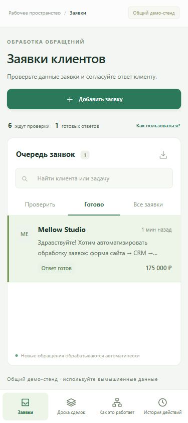

# BriefOps

### Клиентские заявки. Структурированные данные. Проверенные ответы.

BriefOps — рабочее пространство для обработки входящих обращений. Система разбирает сообщение клиента, проверяет повторы, создаёт сделку и готовит черновик ответа. Менеджер уточняет данные и согласует результат в одной карточке.

[Открыть приложение](https://briefops.onrender.com) · [Обзор решения](PORTFOLIO.md) · [Сайт и email](WEBSITE_EMAIL.md) · [API и n8n](N8N_SETUP.md) · [Развёртывание](DEPLOYMENT.md)


<details>
<summary>Мобильная версия</summary>



</details>

## От первого сообщения до готового ответа

1. **Добавьте заявку.** Вставьте сообщение или передайте обращение через API. Имя, компания и источник — необязательные поля.
2. **Получите результат обработки.** BriefOps выделит задачу, контакт, бюджет и срочность, назначит ответственного и создаст сделку. Точный повтор останется в истории без второй сделки.
3. **Проверьте и согласуйте.** Исправьте поля, отредактируйте черновик и сохраните готовый ответ. Текст доступен для копирования; каждое действие записывается в историю.

В интерфейсе есть очередь проверки, раздел готовых ответов, доска сделок и журнал обработки. Сценарий «Попробовать на примере» позволяет пройти весь процесс на одной заявке.

## Возможности

| Задача | Реализация |
| --- | --- |
| Разобрать свободный текст | AI определяет услугу, краткое содержание и срочность; код извлекает контакт и бюджет |
| Сохранить обращение до обработки | Постоянная очередь заданий в Postgres или SQLite |
| Избежать повторных сделок | Идемпотентность по ID источника и проверка точных повторов |
| Подготовить первый ответ | Шаблон учитывает известные данные, недостающие поля и бюджет |
| Сохранить контроль менеджера | Редактирование полей и текста, согласование и история действий |
| Пережить временный сбой | Три попытки с задержкой, ручной повтор и восстановление задания |
| Не забыть об ответе | Внутренняя задача при превышении 20 минут без согласования |
| Подключить источник | Прямая форма World of Vibecraft, Bearer API, процессы n8n |
| Отправить email | Закрытый кабинет, отдельное подтверждение менеджера и подписанный Google MailApp |
| Разделить рабочие данные и демо | Neon Auth, проверенный владелец и отдельная база заявок |

## Архитектура

```text
Форма / внешний источник
          ↓
HTTP API → постоянная очередь → AI-разбор + проверка полей
                                      ↓
                    защита от повторов → сделка + черновик
                                                ↓
                         менеджер → согласованный ответ
```

- **Backend:** Python, HTTP API, транзакционная обработка.
- **Хранение:** Neon Postgres с psycopg 3 и пулом соединений; SQLite для автономного запуска.
- **AI:** NVIDIA Nemotron, JSON-ответ с проверкой схемы и резервным разбором по правилам. OpenRouter поддерживается как альтернативный провайдер.
- **Frontend:** HTML, CSS, JavaScript. Интерфейс не зависит от внешних шрифтов и CDN.
- **Развёртывание:** Render, декларация `render.yaml`; настройки Neon в `neon.ts`.

## Запуск

Python 3.11+. Установите зависимости в виртуальное окружение:

```bash
python -m venv .venv
# Linux / macOS
source .venv/bin/activate
# Windows PowerShell
# .\.venv\Scripts\Activate.ps1
pip install -r requirements.txt
python app.py
```

Откройте [localhost:8787](http://127.0.0.1:8787). Без `DATABASE_URL` используется локальная SQLite. При первом запуске создаётся набор тестовых обращений.

Для Postgres добавьте `DATABASE_URL` и `DATABASE_URL_UNPOOLED` в `.env.local`. Для AI задайте настройки из `.env.example` и запустите `python app.py --llm`. Режим `--rules` работает без вызовов модели.

[Переменные среды, HTTPS и Render](DEPLOYMENT.md) · [Контракт API и n8n](N8N_SETUP.md)

## Проверка

```bash
npm ci
npm run build
python -m unittest discover -s tests -v
```

Проверяются идемпотентность, конкурентный приём, повторы, очередь, retry, восстановление, согласование, контроль времени ответа и защита API. [Методы проверки и облачный сценарий](QA.md).

## Публичный стенд

[briefops.onrender.com](https://briefops.onrender.com) — общая среда с вымышленными данными. Используйте её для знакомства с процессом. Согласование сохраняет ответ внутри демо и не отправляет сообщения. Для реальных заявок предусмотрен [закрытый кабинет](https://briefops.onrender.com/login) с отдельной базой и входом владельца. Он поддерживает приём формы World of Vibecraft и подтверждённую менеджером отправку email через Google MailApp. Telegram и внешняя CRM подключаются отдельно. [Устройство интеграции](WEBSITE_EMAIL.md).

[История изменений](CHANGELOG.md)
